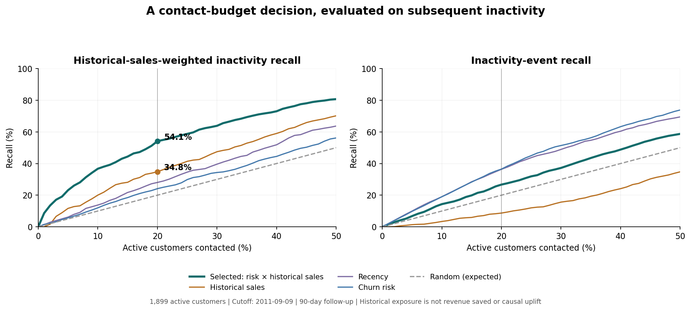
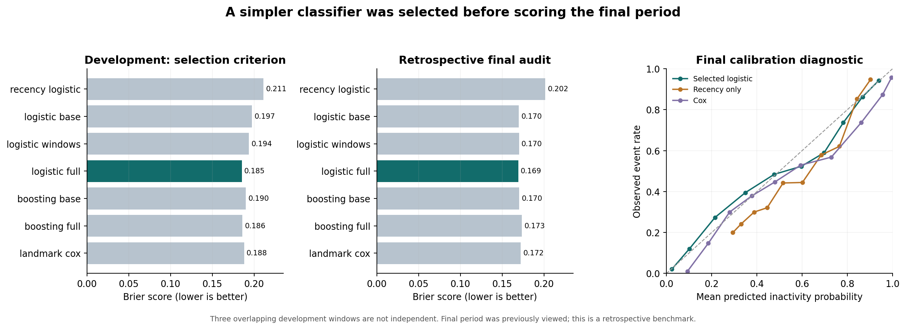

# Customer targeting: technical decisions and resume evidence

This extension implements the improvement plan: budget-constrained targeting, stronger churn comparators, behavioral feature ablation, supervised spending challengers, and reproducible presentation. Results are measured on the local Online Retail dataset. No new transactions, treatment outcomes, margin assumptions, paid LLM runs or synthetic business-impact metrics were introduced.

## The decision

**Which active customers should a retailer prioritize when it can contact only 5%, 10% or 20% of its customer base?**

The objective is historical-sales-weighted recall of future inactivity. For customer i, let `v_i` be their gross positive sales in the 90 days BEFORE the scoring cutoff, and `y_i` indicate a first inactivity crossing in the following 90 days:

`weighted recall = sum(v_i * y_i for selected customers) / sum(v_i * y_i for all active customers)`.

All values used for ranking are available at the cutoff. Future labels are used only to score the policy. This objective expresses which previously valuable customers subsequently became inactive. **It does not measure revenue lost, recoverable revenue, incremental profit or campaign ROI.** Inactivity can be followed by reactivation.

## What was selected, and why

| Component | Development-selected choice | Evidence and tradeoff |
|---|---|---|
| Churn | Standardized L2 logistic regression with 18 behavioral features | Mean development Brier 0.1851 vs 0.1879 Cox and 0.1858 full boosting; no PH assumption is required for the classifier |
| Spending | Existing BG/NBD + Gamma-Gamma | Mean development MAE £451.24 vs £471.10 recent spending, £517.08 two-part GLM and £528.25 two-part boosting |
| Contact policy | Predicted inactivity probability × trailing-90-day gross sales | Mean development weighted recall at 20% budget 52.78%, vs 40.26% spending-only and 26.96% probability × predicted CLV |

These three choices use three DEVELOPMENT cutoffs: 2011-04-09, 2011-05-09 and 2011-06-09. Their 90-day outcomes all complete before the final scoring cutoff. Follow-ups overlap, and customers recur; these are not three independent experiments. Initial training cohorts also have shorter available history because the dataset starts in December 2010.

`analytics/decision_protocol.json` records candidates, fixed settings, objectives and budgets. `model_selection.json` is written from development metrics before the evaluator scores the final fold. No hyperparameter search was performed. The final period, 2011-09-10 through 2011-12-08, had already been viewed in the earlier review; this extension remains a **retrospective benchmark**, not a newly unseen test. Selection rules and settings were fixed before this extension's first candidate evaluation.

## Strongest new result: targeting at a fixed budget

Final cohort: **1,899 active customers**, 940 subsequent inactivity events. Contacting 20% means selecting **380** customers after rounding up.

| Policy | Historical-sales-weighted recall, 5% budget | 10% budget | 20% budget |
|---|---:|---:|---:|
| Random, analytical expectation | 5.0% | 10.0% | 20.0% |
| Recency | 6.2% | 13.8% | 28.1% |
| Historical sales | 11.7% | 20.0% | 34.8% |
| Churn probability | 5.7% | 12.0% | 24.1% |
| Predicted CLV | 6.2% | 9.9% | 22.0% |
| Churn probability × predicted CLV | 15.7% | 22.2% | 32.6% |
| **Selected: churn probability × historical sales** | **23.1%** | **36.7%** | **54.1%** |

At a 20% budget, the selected policy covers **54.12%** of historical-sales exposure among subsequently inactive customers, versus **34.83%** from spending-only ranking: **+19.29 percentage points**, conditional paired-bootstrap 95% CI **[+12.74, +23.59] pp**.

The £236,652.64 exposure identified by the selected policy and £152,293.64 by spending-only are historical gross-sales totals attached to future inactive customers. They are NOT money that a campaign saved or generated.

There is an intentional tradeoff: the selected policy finds 251 events (precision 66.05%, recall 26.70%), whereas ranking by churn risk alone finds 343 events (precision 90.26%, recall 36.49%). Weighting value sacrifices event count to prioritize customers with more historical spending. Reporting only the weighted result would hide this decision.



A post-hoc robustness check adds a stronger comparator: **recency-only probability × historical sales**. It covers 42.53% at the same budget. The selected policy's advantage is **+11.60 pp**, conditional 95% CI **[+5.53, +15.34] pp**. This comparator was added after primary results were inspected and was NOT used to choose the policy. Its status is recorded in `decision_evaluation.json`.

An additional retrospective diagnostic: to cover 50% of weighted exposure, the selected ranking needs 351 customers, versus 621 for spending-only ranking (43.5% fewer). This threshold is identified using realized outcomes; it is not a deployable guarantee that contacting 351 future customers will achieve that coverage. The predeclared 20% budget comparison is the stronger resume claim.

## Model comparisons and ablation

Every classifier uses the same completed historical training landmark and the same active scoring cohort. Training labels finish by scoring time. Fixed settings: logistic C=1; boosting 100 iterations, 7 leaves, minimum 40 samples/leaf, learning rate .05, L2=1, random early stopping disabled. Limiting tree complexity and skipping random early stopping prevents hidden random validation across time.

The 18 features consist of:

- Base: log invoice count, log mean invoice value, log product diversity, recency and tenure.
- Windows/trend: purchase-day counts and gross sales over 30/60/90 days, and recent-vs-previous-30-day changes.
- Cadence/reactivation: average interpurchase gap, gap coefficient of variation, recency relative to purchase cadence, repeat-purchase indicator and number of prior 90-day inactivity gaps.

Features are created by one shared function for evaluation and serving. One-time buyers receive an explicit 90-day cadence prior and a missing-history indicator. No future-cohort statistics are used to fill these values.

| Churn candidate | Mean development Brier ↓ | Final Brier ↓ | Final ROC-AUC |
|---|---:|---:|---:|
| Recency-only logistic | .2112 | .2016 | .7707 |
| Logistic, base features | .1971 | .1700 | .8285 |
| Logistic, base + windows | .1936 | .1701 | .8288 |
| **Logistic, full features** | **.1851** | **.1692** | **.8317** |
| Boosting, base features | .1898 | .1703 | .8281 |
| Boosting, full features | .1858 | .1734 | .8273 |
| Landmark Cox | .1879 | .1721 | .8327 |

Full logistic has a **16.07% lower final Brier score than recency-only logistic**. Difference = −.03240, conditional 95% CI [−.04106, −.02390]. Final log loss = .5004 versus .5851 for recency-only and .5252 for Cox.

Relative to Cox, the Brier difference is only −.00293 and its CI [−.00845, +.00224] contains zero. Cox has slightly higher AUC. Therefore, **do not claim a statistically established performance improvement over Cox**. Logistic was retained for its development criterion, simpler fixed-horizon interpretation and absence of PH assumptions, with comparable ranking.

Mean predicted inactivity is 50.49% versus observed 49.50%. This corrects much of Cox's aggregate overprediction, but some probability bins still deviate meaningfully from observed rates. Calibration plots are diagnostics, not proof of perfect calibration. There was no additional post-hoc calibration fitting on final outcomes.



## Spending models: retain the incumbent and explain the failure

Two-part candidates estimate `P(any purchase) × E(gross sales | purchase)` using either logistic + Gamma GLM, or shallow histogram boosting + a positive-spend Poisson-loss regressor. Poisson loss is used as a nonnegative conditional-mean objective, not a claim that currency follows a Poisson distribution. All settings are fixed; no extra tuning was performed after examining final scores.

| Spending model | Development mean MAE | Final MAE | Final RMSE | Final aggregate bias | Top-20% future-sales capture |
|---|---:|---:|---:|---:|---:|
| Recent sales | £471.10 | £601.99 | £2,825.91 | −30.36% | 65.78% |
| **BG/NBD + Gamma-Gamma** | **£451.24** | **£579.50** | £2,988.09 | −40.47% | **69.36%** |
| Two-part GLM | £517.08 | £623.97 | £3,644.53 | −38.22% | 67.17% |
| Two-part boosting | £528.25 | £607.52 | £3,126.15 | −27.86% | 67.12% |

Boosting improves the aggregate-bias point estimate but worsens the primary MAE and other metrics; it is not promoted. The incumbent retains the strongest measured MAE/ranking tradeoff among these candidates. Its MAE advantage over recent sales still has an interval containing zero, and it remains worse in RMSE. No claim of accurate total revenue forecasting is justified.

An exact, outcome-based diagnostic decomposes the incumbent's £1,075,607.98 aggregate shortfall:

- £645,461.02 (60.01%) is the purchase-frequency component: `(actual purchase-days − predicted purchase-days) × predicted day value`.
- £430,146.96 (39.99%) is the remaining purchase-day-value component.

This uses observed future counts only to understand errors; it is an oracle diagnostic, NOT a forecast or causal explanation. It suggests that tuning the monetary model alone cannot remove the full aggregate shortfall. Short history, seasonal demand and sparse one-time-buyer histories remain limitations; their causal contributions were not established.

## Serving and reproducibility

The selected decision policy is served by `POST /retention/targets`:

```json
{"cutoff_date":"2011-09-09","contact_fraction":0.2}
```

It returns 380 ranked customers, selected model/policy names, probabilities, historical sales, expected 90-day gross spending and explicit interpretation limits. It does NOT return future labels or the evaluation's exposure/recall metrics. The response does not claim a guaranteed realized coverage for new predictions.

The LLM retention tool now uses this same policy and accepts `contact_fraction`. Its capped display count is reported separately from total contacts allowed by the budget. Existing Cox survival endpoints remain available as distinct analytical tools; existing `/clv` retains BG/NBD–Gamma-Gamma. Do not describe all endpoints as using one classifier or one horizon.

The service rejects future cutoffs outside observed data, detects a stale protocol/selection hash, trims future rows before fitting, and keys its bounded prediction cache by data content, cutoff and selection. The older shared transaction/CLV/Cox caches still require process restart after database changes. The final dataset day is partial; benchmark follow-up ends December 8 to avoid claiming a complete December 9 outcome day.

Run from repository root:

```powershell
.\venv\Scripts\python.exe backend/etl/load_online_retail.py
.\venv\Scripts\python.exe backend/evaluate.py
.\venv\Scripts\python.exe backend/evaluate_decisions.py
.\venv\Scripts\python.exe backend/render_decision_report.py
.\venv\Scripts\python.exe -m unittest discover -s backend/tests -v
```

`decision_evaluation.json`, `model_selection.json` and customer-level CSVs preserve the measured results. Figures are rendered from those saved metrics. `requirements-tested.txt` records the tested environment, including scikit-learn 1.8.0. The existing first-review scientific caveats remain applicable; [REVIEW.md](REVIEW.md) documents those findings.

Verification: **31 offline regression/integration tests pass**. They include hand-calculated budget metrics, deterministic tie breaking, identical-policy bootstrap checks, feature-window semantics, development-only selection, API ranking equality with saved offline predictions, a refit after mutating future rows, the default serving cutoff, and budget forwarding in the chatbot tool without invoking an LLM. Python compilation and `git diff --check` also pass. Both figures were visually inspected. Known third-party BG/NBD covariance/deprecation warnings remain; finite point predictions are checked, and unreliable parameter standard errors are not used for inference.

Bootstrap intervals resample customers and recompute capacity-limited rankings. They are conditional on these fitted models and this final time period. They do not incorporate model-selection uncertainty, model refitting, uncertainty across seasons, or a future campaign's treatment effect. No multiple-comparison-adjusted inference is claimed for exploratory comparisons or post-hoc robustness checks.

## Resume bullets — recommended current wording

Lead with targeting and validation. CLV capture of 69.4% versus 65.8% is only a 3.6-percentage-point gain over a simple baseline; no interval was computed for that capture difference. Given its weak aggregate forecasting, keep CLV as supporting analysis rather than a primary resume achievement.

- Backtested seven customer targeting policies under fixed contact budgets, covering 54.1% of historical sales exposure among subsequently inactive customers at a 20% contact budget, versus 34.8% using spending-only ranking.
- Engineered 18 cutoff-safe behavioral features and selected regularized logistic regression across three temporal development windows, achieving 0.832 ROC-AUC and 16.1% lower Brier score than a recency-only baseline on 1,899 customers.
- Built a reproducible Python/SQL customer analytics pipeline processing 541,909 transaction records, with auditable cleaning and 31 offline tests covering temporal leakage, targeting logic, and API prediction parity.

The raw-data scale in the last bullet is 541,909 records; modeling uses 392,692 cleaned records, not 541,909 independent customers. Lead with targeting for Customer/Growth DS roles; the pipeline bullet is optional if only two bullets fit. Explain the historical-exposure definition before discussing the metric in interviews. Never replace it with revenue saved, retention lift or generated revenue.

## Interview narrative

The consequential decision was separating three objectives: predicting inactivity, forecasting spending, and choosing customers under a budget. The classifier with the best AUC was not automatically the selected probability model. The most complex spending model was rejected. CLV-only and risk-only policies were insufficient for the stated value-weighted targeting objective. A simple, cutoff-known value multiplied by a measured probability produced the most useful tested policy, with uncertainty and its event-count tradeoff disclosed.
